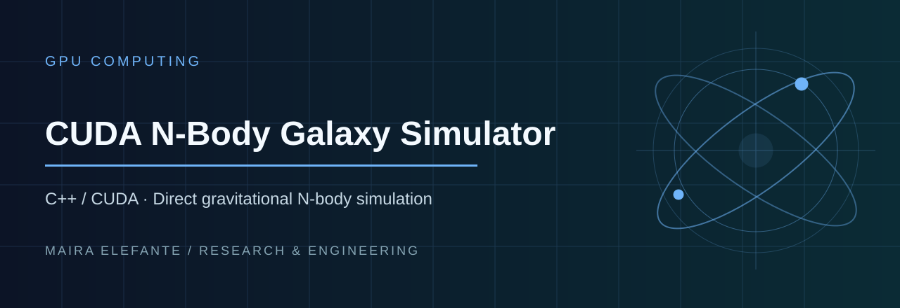

> **C++ / CUDA · Direct gravitational N-body simulation**

**Focus:** GPU Computing · [Source and project files](./)

---

# CUDA N-Body Galaxy Simulator
C++17/CUDA direct-summation gravitational simulation with a CPU reference implementation, tiled shared-memory CUDA kernel, validation and benchmarks.

CPU-only build:
```bash
cmake -S . -B build
cmake --build build --config Release
```
CUDA build:
```bash
cmake -S . -B build -DENABLE_CUDA=ON
cmake --build build --config Release
```
Run CPU: `nbody_cpu 2000 20 cpu.csv`
Run GPU: `nbody_cuda 10000 100 gpu.csv`
Benchmark: `nbody_cuda --benchmark`

The model uses dimensionless units and synthetic initial conditions.
